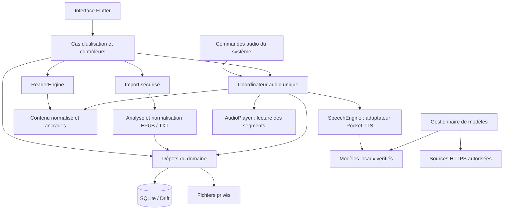
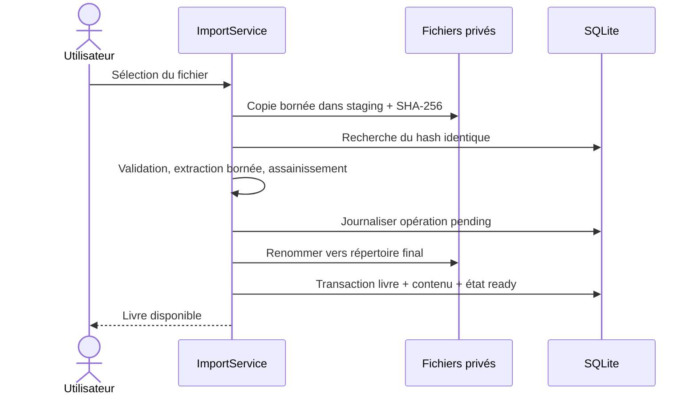
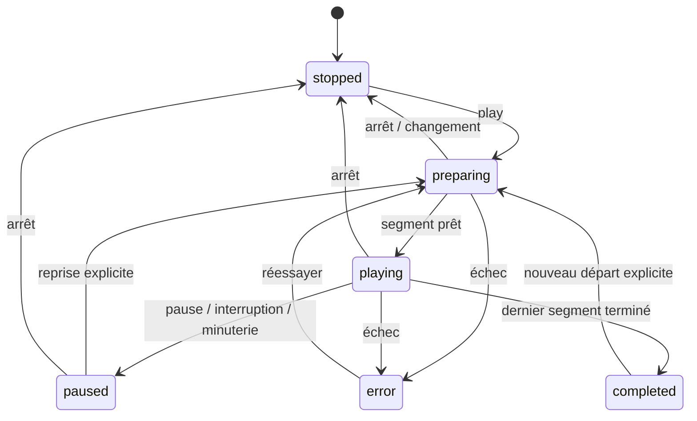

# Architecture technique — uReader

Version : 0.1 — 10 novembre 2026  
Statut : architecture cible proposée, non implémentée  
Références : [PRD](PRD.md), [Cahier des charges](Cahier-des-charges.md), [Base de données](Base-de-donnees.md), [API internes](API.md), [Décisions d’architecture — ADR](ADR/README.md)

## 1. Choix structurants

uReader est conçu comme une application Flutter locale, organisée en modules fonctionnels. SQLite conserve les données structurées ; les livres, modèles et fichiers audio restent sur le système de fichiers privé. La lecture visuelle ne dépend pas de la disponibilité du moteur vocal.

Android est confirmé comme première plateforme et le français comme langue prioritaire de synthèse par le porteur du projet le 2026-11-10. Les appareils, versions Android minimum et voix françaises restent à définir et à valider techniquement. EPUB/TXT, absence de compte et synthèse sur appareil restent les hypothèses du PRD. Cette architecture ne les transforme pas en décisions produit validées. Elle ne prévoit pas de serveur applicatif ni d’API REST pour la première version locale.

| Choix | Proposition et justification | Statut |
|---|---|---|
| Interface | Flutter, avec modules bibliothèque, lecteur, écoute et réglages | Framework demandé |
| Persistance | SQLite avec Drift pour requêtes typées, transactions et observation des données | Proposé |
| État et injection | Contrôleurs par fonctionnalité et injection par constructeur ; bibliothèque d’état à choisir lors du squelette Flutter | Contrats définis, outil ouvert |
| Audio | `audio_service` pour commandes système et session ; `just_audio` comme lecteur de segments générés | Candidats à prototyper |
| Synthèse | Adaptateurs locaux derrière `SpeechEngine` : Kokoro SIWIS en développement, Pocket historique explicite | ADR-0011 ; qualifications natives et produit distinctes |
| Rendu EPUB | Adaptateur `ReaderEngine`, avec document assaini et ancrages partagés avec TTS | Moteur de rendu à sélectionner par prototype |
| Concurrence | Traitements lourds hors du fil UI ; coordination unique de l’audio et des écritures de position | Exigence architecturale |

Drift est une bibliothèque réactive reposant sur SQLite ; `audio_service` expose les événements audio de fond et les commandes système ; `just_audio` fournit la lecture audio. Ces capacités motivent les candidats, sans valider leur assemblage pour uReader. Sources : [Drift](https://pub.dev/packages/drift), [audio_service](https://pub.dev/packages/audio_service), [just_audio](https://pub.dev/packages/just_audio).

## 2. Schéma des composants



L’interface dépend des cas d’utilisation. Ceux-ci dépendent d’interfaces du domaine ; les adaptateurs de stockage, rendu et synthèse implémentent ces interfaces. Un écran ne lance pas directement un téléchargement, une requête SQL ou une synthèse. Le domaine ne dépend pas des widgets Flutter.

## 3. Organisation du code cible

```text
lib/
  app/                      # Assemblage, navigation, injection, cycle de vie
  core/                     # Erreurs typées, identifiants, horloge, annulation
  features/
    library/                # Import, liste, recherche, suppression
    reader/                 # Navigation, signets, recherche dans le livre
    listening/              # Session, file de segments, minuterie
    settings/               # Préférences, stockage, modèles
  domain/                   # Entités et contrats partagés
  infrastructure/
    database/               # Schéma Drift, migrations, dépôts
    files/                  # Stockage privé et journal d'opérations
    parsing/                # Validation EPUB/TXT et normalisation
    rendering/              # Adaptateur ReaderEngine
    speech/                 # Adaptateur Pocket TTS et runtime natif
    audio/                  # Commandes système et lecteur
    downloads/              # Téléchargement et validation des modèles
test/                       # Règles métier, persistance, sécurité des entrées
integration_test/           # Parcours et cycle de vie sur appareil
```

Cette arborescence est une proposition de structure, pas la description de fichiers déjà présents.

## 4. Contenu, rendu et positions stables

L’import produit une représentation canonique versionnée : ressources assainies, ordre de lecture, chapitres, blocs textuels et correspondance vers le document rendu. Le moteur visuel et le découpage TTS utilisent cette même représentation. Aucune position n’est dérivée uniquement d’un numéro de page ou de la taille de police.

Un `Locator` comprend `bookId`, `contentVersion`, `resourceId`, `blockId` et `offsetUtf16`. L’offset compte les unités UTF-16 du texte canonique, jamais les octets ni les caractères affichés. Un offset doit être validé sur une frontière de caractère valide. Les segments audio sont des plages de ces blocs ; une reprise peut relire le début du segment sans prétendre à un alignement mot à mot.

Les identifiants de blocs sont créés à l’import et persistent. Le normaliseur ne réécrit pas silencieusement le contenu d’un livre existant. Un changement de format canonique exige une migration des ancrages ou le maintien de l’ancien contenu. Un repère invalide entraîne un retour signalé au bloc ou chapitre valide le plus proche, sans inventer une correspondance exacte.

Le prototype de rendu doit prouver la correspondance sélection/paragraphe/ancrage et l’accessibilité. Une WebView éventuelle ne doit charger que le contenu assaini, bloquer réseau et scripts du livre et ne proposer aucun pont privilégié accessible au document. Si le rendu nécessite un script de confiance, son isolation vis-à-vis du document doit être démontrée avant adoption ; sinon le candidat est rejeté.

## 5. Import transactionnel et suppression



Le schéma montre le succès ; un doublon retourne l’identifiant existant avant extraction. Une contrainte unique sur le hash arbitre également deux imports simultanés. Le perdant nettoie sa copie temporaire.

SQLite et les fichiers ne partagent pas une transaction atomique : un journal d’opérations rend les actions rejouables. Au redémarrage, un service de réconciliation termine ou annule les imports interrompus et nettoie les répertoires orphelins. Un livre n’est visible comme prêt que lorsque ses fichiers sont présents et validés.

Pour supprimer : invalider et arrêter la session audio du livre, le marquer `deleting` et journaliser, supprimer ses fichiers de manière idempotente, puis supprimer les lignes en transaction avec cascades. Un échec conserve l’opération à reprendre ; il n’est pas annoncé comme une suppression terminée. Aucun chemin du fichier original n’est utilisé pour cette opération.

## 6. Pocket TTS et audio

Évolution du 26 novembre : Kokoro SIWIS utilise le même propriétaire natif et les
mêmes canaux derrière `SpeechEngine`, avec ONNX Runtime 1.25.0 et eSpeak 1.52.0
épinglé. Le manifeste Kokoro et sa preuve technique sont distincts du gate G0
Pocket. Le profil de développement est bloqué en product/profile et sans
FLAG_DEBUGGABLE. La sélection explicite du profil traverse catalogue, coordinateur,
résolveur et cache ; aucun modèle ni serveur de substitution n'est choisi en erreur.
Les données phonétiques dérivées sont extraites sous quotas dans un dossier privé
identifié par empreinte et libérées à la fermeture du backend. Le suivi de paragraphe
est préservé ; les durées phonétiques ne qualifient pas le suivi précis des mots.
Voir [ADR-0011](ADR/0011-kokoro-siwis.md).

La référence officielle Pocket TTS présente une interface Python et une génération audio en streaming sur CPU. Cela ne démontre pas une intégration Flutter/Android prête à distribuer. Le pont proposé est donc une frontière d’architecture, pas un SDK mobile présumé disponible. Source : [dépôt officiel Pocket TTS](https://github.com/kyutai-labs/pocket-tts).

Un prototype doit sélectionner un runtime redistribuable et mesurer compatibilité des modèles, langues, latence, mémoire et consommation sur les appareils retenus. Un port natif via FFI ou canaux de plateforme n’est adopté qu’après preuve. Aucun serveur Python local, service distant ou remplacement de moteur n’est introduit automatiquement pour contourner une difficulté.

### Pipeline proposé

1. Le coordinateur alloue `sessionId` et `generation`, lit le repère et vérifie la disponibilité du modèle/voix/langue.
2. Le segmenteur produit des plages bornées dans le texte canonique ; une phrase trop longue est divisée avec correspondance conservée.
3. Le moteur génère un segment ; le résultat complet est validé et publié atomiquement dans le cache.
4. Le lecteur joue les segments prêts. La préproduction est bornée pour appliquer une contre-pression et limiter mémoire et disque.
5. Le début du segment réellement joué devient le repère audio durable. La simple génération ou mise en file ne fait pas avancer la progression.
6. Chaque retour asynchrone porte le couple session/génération. Après arrêt, déplacement ou changement de livre, les anciens retours sont ignorés et leurs ressources libérées.

Le premier prototype utilise des fichiers complets par segment pour simplifier la reprise. La lecture de PCM en streaming est une optimisation éventuelle, conditionnée par la latence mesurée et le lecteur choisi. La vitesse est appliquée par le lecteur dans la plage validée ; si elle ne modifie pas la génération, elle ne change pas la clé du cache.



Le service audio de fond possède le coordinateur ; l’interface et les commandes système envoient des intentions au même propriétaire. Un isolate Dart seul n’est pas une garantie de survie en arrière-plan. Le prototype Android doit vérifier service de premier plan, audio focus, notifications, commandes système et restrictions de batterie selon les versions cibles.

Les écritures audio et visuelles sont séparées, ordonnées et protégées contre les retours obsolètes. À la relance, on restaure les repères, jamais une lecture sonore automatique. La minuterie utilise une horloge monotone tant que le processus vit et n’est pas réarmée après redémarrage.

## 7. Stockage et sécurité

```text
private/
  database/ureader.sqlite
  books/<bookId>/original + canonical/ + resources/ + cover
  models/<modelId>/<version>/
  staging/<operationId>/
cache/
  audio/<cacheKey>/
```

Les chemins enregistrés sont relatifs à des racines contrôlées. Leur résolution vérifie l’appartenance à la racine ; noms d’archive, URI de livre et entrées externes ne deviennent jamais des chemins arbitraires.

- Import : limites avant et pendant copie/décompression, rejet des traversées et liens, parseur XML sans entités externes, assainissement HTML/CSS et images bornées.
- Rendu : ressources locales autorisées uniquement ; schémas externes proposés `https` et `http`, sur action utilisateur et ouverture système. Bloquer notamment `javascript`, `file`, `intent` et schémas inconnus.
- Modèles : manifeste de confiance livré avec l’application ou signé par une clé épinglée, URLs autorisées et redirections revalidées ; taille et hash attendus, vérification avant renommage/activation. Aucun code exécutable téléchargé.
- Données : stockage privé, exclusion des sauvegardes automatiques conformément au PRD, pas de contenu ni chemins personnels dans les diagnostics, aucune télémétrie distante par défaut.
- Réseau : seul le gestionnaire de modèles dispose d’un client réseau dans le périmètre local. Le parseur, le rendu et la synthèse n’en dépendent pas.

Le cache est supprimable par le système et n’est jamais une source de vérité. Une clé inclut identité du contenu, version canonique, plage textuelle, modèle/version, voix et paramètres affectant la génération. La suppression ou l’éviction ignore les éléments verrouillés par une session active.

## 8. Migrations et reprise

Le schéma SQL et le format canonique sont versionnés séparément. Les migrations SQL sont transactionnelles et testées sur des données existantes. Les migrations de fichiers sont journalisées et reprenables. Une erreur ne déclenche jamais un effacement de la bibliothèque.

Avant une migration risquée, prévoir une copie locale de récupération des données concernées, privée et temporaire ; la nettoyer après validation. En cas d’espace insuffisant, conserver l’ancienne version et exposer une erreur récupérable. Les tests simulent les arrêts entre chaque étape fichiers/SQLite.

## 9. Validation de l’architecture

| Porte de validation | Preuve requise | Exigences principales |
|---|---|---|
| Runtime Pocket TTS | Appareil réel, modèle/voix/langue, licence et distribution vérifiés | F-09, DEC-02/03 |
| Rendu et repères | Réglages, sélection, recherche et TTS pointent le même bloc ; lecteur d’écran utilisable | F-04 à F-08, F-14, QUAL-01 |
| Fond audio | Verrouillage, appel, retrait écouteurs, minuterie et changement de livre | F-10 à F-13, RM-12 à RM-15 |
| Données | Arrêts brutaux, imports concurrents, suppression interrompue, migrations | RM-01 à RM-10, QUAL-05 |
| Sécurité | Archives hostiles, scripts, ressources distantes et modèle altéré refusés | SEC-01 à SEC-12 |

Les limites chiffrées d’archives, cache, préproduction et latence sont à fixer dans le rapport de prototype avant livraison. Les choix de bibliothèques seront consignés avec versions et licences après ces validations. Aucun de ces prototypes ni tests n’est présenté comme déjà exécuté.
