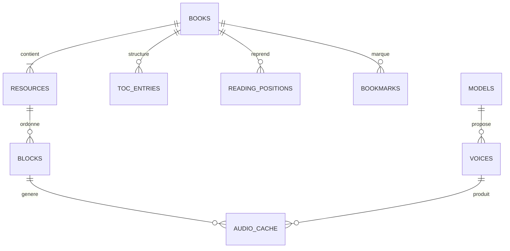

# Base de données — uReader

Version : 0.1 — 10 novembre 2026  
Statut : modèle logique proposé, schéma exécutable à produire lors de l’implémentation  
Référence : [Architecture](Architecture.md)

## 1. Principes

SQLite est la source de vérité des métadonnées, repères et préférences. Les fichiers binaires restent hors base. Drift est le candidat d’accès aux données. Les identifiants sont des UUID textuels générés localement ; dates en millisecondes UTC, durées en millisecondes, tailles en octets. Les enums décrits ci-dessous devront avoir des contraintes `CHECK`.

Activer les clés étrangères sur chaque connexion. Les écritures passent par un propriétaire coordonné ; les transactions restent courtes, sans téléchargement ni génération audio à l’intérieur. Le journal WAL est proposé, avec politique de durabilité vérifiée sur appareils cibles et sauvegardes cohérentes incluant son état.

## 2. Schéma relationnel

La table `operations` journalise les actions fichiers/base sans clé étrangère obligatoire, pour permettre le nettoyage après suppression du livre. Les préférences sont indépendantes des ouvrages.

## 3. Tables

Les champs sont obligatoires sauf mention `nullable`. Les chemins sont relatifs, validés par le stockage privé et ne contiennent jamais le chemin source de l’utilisateur.

| Table | Champs proposés | Contraintes et index |
|---|---|---|
| `books` | `id`, `sha256`, `format`, `title`, `authors_json`, `language` nullable, `original_path`, `cover_path` nullable, `content_version`, `status`, `byte_size`, `created_at`, `last_opened_at` nullable, `last_mode` | PK `id` ; UNIQUE `sha256` ; format `epub/txt` ; status `ready/deleting/unavailable` ; mode `visual/audio` ; taille ≥ 0 ; index titre normalisé et dernière ouverture |
| `resources` | `id`, `book_id`, `ordinal`, `source_href`, `canonical_path`, `text_length` | FK livre CASCADE ; UNIQUE `(book_id, ordinal)` et `(book_id, id)` ; ordinal et longueur ≥ 0 |
| `blocks` | `id`, `book_id`, `resource_id`, `ordinal`, `text`, `text_length`, `source_anchor` nullable | FK composite `(book_id, resource_id)` vers resources CASCADE ; UNIQUE `(book_id, id)` et `(resource_id, ordinal)` ; texte canonique, longueur UTF-16 vérifiée à l’écriture |
| `toc_entries` | `id`, `book_id`, `parent_id` nullable, `ordinal`, `label`, `resource_id`, `block_id` nullable, `offset_utf16` | FK livre CASCADE ; FKs composites vers ressource/bloc du même livre ; parent du même livre ; cible validée par service |
| `reading_positions` | `book_id`, `mode`, `resource_id`, `block_id`, `offset_utf16`, `content_version`, `revision`, `updated_at` | PK `(book_id, mode)` ; FKs composites vers ressource/bloc du même livre ; mode visual/audio ; offset et revision ≥ 0 |
| `bookmarks` | `id`, `book_id`, `resource_id`, `block_id`, `offset_utf16`, `content_version`, `label` nullable, `created_at` | PK id ; mêmes contraintes de cible ; index `(book_id, created_at)` |
| `models` | `id`, `version`, `engine_version`, `manifest_digest`, `relative_path`, `sha256`, `byte_size`, `status`, `installed_at` nullable | PK `(id, version)` ; status downloading/verifying/ready/error ; seuls les fichiers vérifiés deviennent ready |
| `voices` | `id`, `model_id`, `model_version`, `language`, `display_name`, `configuration_json` | PK id ; FK modèle/version ; pas de voix personnalisée importée en V1 |
| `audio_cache` | `cache_key`, `book_id`, `block_id`, `start_utf16`, `end_utf16`, `content_version`, `voice_id`, `parameters_digest`, `relative_path`, `duration_ms`, `byte_size`, `last_accessed_at` | PK cache_key ; FK livre/bloc CASCADE ; FK voix ; 0 ≤ début < fin ; durée/taille ≥ 0 ; index dernier accès |
| `preferences` | `key`, `value_json`, `schema_version`, `updated_at` | PK key ; clés autorisées et valeurs typées validées par service |
| `operations` | `id`, `kind`, `target_id`, `phase`, `staging_path` nullable, `final_path` nullable, `created_at`, `updated_at`, `error_code` nullable | PK id ; types import/delete/install_model/migrate ; états explicitement définis par opération ; index phase/date |

Les contraintes de bornes d’offset et de cohérence bloc/ressource exigent une validation dans le dépôt en plus des clés étrangères. La spécification SQL devra ajouter les clés composites nécessaires pour empêcher les références croisées entre livres et ressources. Les labels et JSON ne sont jamais interprétés comme HTML ou code.

## 4. Recherche et progression

La recherche dans le livre utilise un index FTS5 dérivé de `blocks.text`, si disponible dans le runtime SQLite sélectionné. Un prototype doit valider disponibilité et comportement linguistique. L’index conserve l’identifiant du bloc ; il est maintenu dans la transaction d’import/suppression et peut être reconstruit. Les requêtes sont paramétrées et la syntaxe FTS utilisateur est échappée ou construite par le service ; aucun SQL brut n’est accepté.

Les résultats exposent des offsets dans le texte canonique. Les offsets retournés par un outil de recherche sont convertis explicitement vers UTF-16 avant création d’un Locator. Une recherche de phrase ou de sous-chaîne doit avoir une sémantique spécifiée et testée ; FTS seul ne garantit pas toutes ces recherches. La recherche titre/auteur utilise leurs valeurs normalisées, pas une dépendance au découpage FTS du contenu.

La progression est calculée à partir du nombre d’unités de texte précédant le repère dans l’ordre canonique. Elle est bornée entre 0 et 1 et indépendante du rendu. Pour un livre sans texte exploitable, afficher une progression indéterminée plutôt qu’une division par zéro.

## 5. Cohérence et concurrence

- Une écriture de position indique le mode et la révision attendue. Le dépôt rejette une révision obsolète ; la mise à jour du repère et du dernier mode est atomique.
- Le coordinateur audio est seul auteur des repères audio. Les actions visuelles n’écrivent que le repère visuel, sauf commande explicite « écouter ici » transmise au coordinateur.
- Les transactions d’import créent livre, ressources, blocs et table des matières ensemble après publication des fichiers ; le journal assure la récupération entre ces deux étapes.
- Supprimer le cache ou un modèle retire d’abord les fichiers selon un protocole rejouable ; une ligne orpheline de cache est traitée comme un cache absent, jamais comme une perte de livre.
- La suppression d’une voix/modèle purge les entrées cache liées après arrêt et déverrouillage des sessions concernées ; elle ne supprime pas les repères audio.

## 6. Migrations et tests prévus

Version initiale cible : schéma 1. Chaque évolution aura une migration ordonnée, un test sur une base de la version précédente et des invariants d’intégrité. Ne jamais utiliser une recréation destructive comme récupération automatique.

Vérifier : contrainte de doublon concurrent, interdiction des repères inter-livres, cascades, reprise après arrêt fichiers/SQL, FTS après suppression, offsets Unicode, migrations et stockage saturé. Ce document décrit les contrôles à implémenter ; aucune base de production n’a encore été créée.
